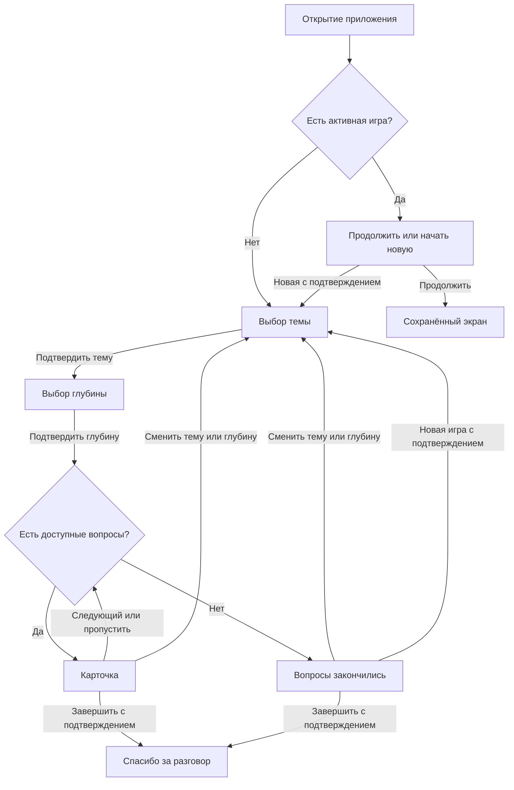

# Экраны, переходы и интерфейс

Редакция v1.0 · **Требования и техническая детализация.** Продуктовая механика утверждена; параметры визуального поведения и уточнения переходов — П-04/05/08.

## Основной путь

На каждом изменении сначала успешное сохранение, затем принятие перехода. Ошибка не оставляет пользователя с карточкой, которая не сохранена. Диаграмма показывает нормальные переходы; ошибки описаны ниже.

## S1. Выбор темы

Первый содержательный экран новой игры. Заголовок «О чём поговорим?». Шесть крупных разделов с точными названиями тем. Нажатие выделяет один, не переключает экран. Рядом доступны рулетка, «Крутить» и «Продолжить». Рулетка имеет шесть равных секторов, соответствующих темам; длинные полные названия доступны в списке, не должны быть нечитаемыми на колесе. Сектор может иметь номер и короткую подпись, результат всегда дублируется полным названием.

До выбора «Продолжить» недоступно. Рулетка после остановки только выделяет тему. Можно крутить снова или выбрать раздел. Доступны «Как играть» и, если игра уже начата, «Завершить игру». Смена темы в текущей игре не очищает показанные карточки. Исчерпанные темы не скрывать и не менять их шансы.

## S2. Выбор глубины

Показывает выбранную тему и заголовок «Глубина разговора». Три варианта:

- Уровень 1 — Лёгкий: предпочтения, простые воспоминания, воображение.
- Уровень 2 — Исследовательский: личный опыт и открытия.
- Уровень 3 — Глубокий: отношения, ценности и важное.

Это пояснения интерфейса, не редактура вопросов. Они не означают возрастной допуск. Три равных сектора рулетки. Ручной выбор, повтор вращения, отдельное «Продолжить». «Назад к темам» не выдаёт вопрос. Есть краткое напоминание: «Можно выбрать другой уровень или пропустить любой вопрос».

## S3. Карточка

Тема, название уровня, точный текст вопроса и номер карточки 1…60 (номер не прогресс). Основное действие «Следующий вопрос», отдельное «Пропустить». Ни одно действие не запрашивает, кто отвечал или ответили ли обе. Во время разговора экран статичен, без автоматического листания и таймера.

Дополнительные действия: «Сменить тему или глубину», «Завершить игру», «Как играть». Пропуск не требует объяснения и не вызывает отрицательного сообщения. «Следующий» и «Пропустить» одинаково сохраняют запрет повтора, но пользовательский смысл различается. Кнопку предыдущего вопроса не добавлять: это не согласованная функция.

«Сменить тему или глубину» возвращает S1 с прежней темой, которую можно сразу подтвердить для изменения только глубины. Не добавлять два разных неоговорённых режима игры.

## S4. Исчерпание

«В этой теме и на этом уровне вопросы закончились». Действия: «Сменить тему или глубину», «Начать новую игру», «Завершить игру». Не показывать кнопку «Повторить вопросы» и не сбрасывать shownIds автоматически.

Если показаны все 60, текст «Все вопросы этой игры уже были показаны», доступны новая игра и завершение; смена выбора не нужна. Никакой оценки успеха и обязательного достижения 60.

## S5. Возвращение

Если найден валидный активный снимок: «Продолжим разговор?» и действия «Продолжить», «Начать новую». «Продолжить» открывает сохранённый phase; для карточки тот же вопрос, для выбора — тот же готовый выбор. Возвращение не создаёт новую случайность. Новая игра через подтверждение замены.

Сохранение доступно только на этом устройстве/адресе/профиле. В правилах кратко: «Ответы не записываются. Сохраняется только ход игры. Очистка данных сайта удалит его».

## S6. Подтверждения и завершение — П-08

«Начать новую игру? Текущая игра будет завершена, все вопросы снова станут доступны». Действия «Начать новую», «Остаться». Если активной игры нет, лишнее подтверждение не нужно.

«Завершить игру?» — «Завершить», «Продолжить разговор». После подтверждённого удаления снимка: «Спасибо за разговор» и «Начать новую игру». Без счёта, оценки, обязательной обратной связи и сохранённого архива встреч.

Фокус при открытии диалога внутри него, при закрытии возвращается к вызвавшей кнопке; не дублировать действия на фоне. Системное «Назад» сначала закрывает диалог без потери состояния.

## Ошибки и служебные состояния

| Состояние | Сообщение и действие |
|---|---|
| Сохранение недоступно | «Не удалось сохранить ход игры. Попробуйте ещё раз». «Повторить». Не утверждать, что новая карточка сохранена |
| Снимок повреждён или несовместим | Объяснить невозможность продолжения, предложить начать новую через подтверждение. Не удалять исходный снимок при одном открытии |
| Другая вкладка изменила игру | «Игра изменилась в другой вкладке». Загрузить сохранённую игру, не перезаписывать её старой |
| Колода не загружается/невалидна | «Не удалось открыть вопросы». Повтор загрузки; не подставлять выдуманный контент |
| Подготовка автономности | Ненавязчивая строка «Готовим игру для работы без интернета»; не блокирует уже доступную онлайн-игру |
| Офлайн готов | «Можно играть без интернета» только после подтверждённого полного кеша |
| Сбой подготовки | «Не удалось подготовить игру без интернета». Повтор; не сбрасывать игру |
| Новый выпуск | Во время игры не прерывать; после завершения предложить «Обновить приложение» |

## Визуальная спецификация — П-05

Светлый фон; системный шрифт с кириллицей. Шесть различимых акцентных цветов, точные оттенки выбрать на этапе T04 с проверкой контраста. Названия и выбранное состояние всегда различимы без цвета. Карточка занимает основное пространство, действия не перекрывают вопрос.

Вопрос от 24 CSS px, обычный текст от 18. Основные зоны касания от 48×48 CSS px, между соседними кнопками минимум 8 CSS px. На 360 CSS px длинные названия и вопросы переносятся; вертикальная прокрутка допустима, обрезка текста нет. При увеличении текста до 200% действия остаются доступны.

Рулетка: 1,2 с, без звука и вибрации, повторное нажатие блокируется только на время вращения; финальный результат виден текстом и объявляется вспомогательным технологиям один раз. При prefers-reduced-motion — результат сразу, без обязательного ожидания. Ручные разделы/уровни остаются полноценным способом игры.

Проверить TalkBack: названия кнопок, выбранный вариант, заголовок нового экрана, вопрос и доступность пропуска. Не добавлять автозачитывание вслух как отдельную функцию продукта.
